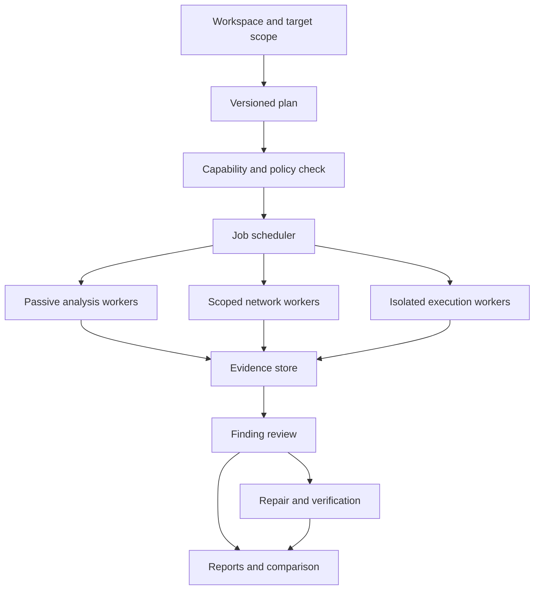

# CodeTwin cybersecurity platform workflow

Status: implementation blueprint, not a declaration that the entire platform exists.
Baseline: main at `23ad5d3cc506f480816b42098dd42efa8433f391` (2026-10-11).

## Product objective

One local-first PC application for source review, authorized application and infrastructure assessment, test execution, finding triage, repair verification and security evidence reporting. CodeTwin owns the workflow, analysis rules, tool contracts, evidence model and UI. Established compilers, protocol libraries, parsers and OS isolation mechanisms remain dependencies; custom implementation does not require rebuilding these primitives.

“All in one” means a consistent workflow and interoperable evidence across a broad, explicitly versioned capability catalog. It does not mean complete coverage of every security domain, universal exploitability detection, or guaranteed accuracy. Each tool exposes supported targets, prerequisites, limits and coverage gaps. No paid external API is required for the core offline workflow; optional online advisory updates and remote services are explicitly configured.

## One end-to-end workflow

| Stage | User action | Required output |
| --- | --- | --- |
| 1. Workspace | Add a repository, owned host/service, test account or imported evidence | Asset identity, environment, local owner, available capabilities |
| 2. Scope | Select allowed files, hosts/IP ranges, ports, paths, identities and exclusions | Immutable engagement scope; ownership/authorization record for active testing |
| 3. Preflight | Inspect installed runtimes, target reachability and permissions | Available/blocked tools, missing prerequisites, estimated request/runtime budget |
| 4. Plan | Choose a preset or individual checks; review requested operations | Tool versions, exact targets, operation risks, budgets and data handling policy |
| 5. Execute | Start the reviewed plan; watch progress or cancel | Durable run ID, per-tool progress, sanitized logs, evidence and partial coverage |
| 6. Review | Inspect observations and reproduce selected findings in the lab | Separate confirmed/review/false-positive decisions with reasons and evidence |
| 7. Repair | Prepare candidate code/configuration changes and review their diff | Base content hashes, proposed bytes, impact, rollback material and selected tests |
| 8. Verify | Re-index, rerun relevant checks and execute supported tests | Before/after evidence; fixed/unresolved/inconclusive outcomes |
| 9. Publish | Explicitly select reviewed changes, commit and optionally open a PR | Git provenance and authenticated publication receipt; no silent push |
| 10. Report | Export a redacted assessment or compare runs | Coverage, findings, reproducibility, residual risks and measured results |

Passive review can proceed without an active engagement. Network requests, repository execution, host collection, privileged operations, repair writes and publication are separate capabilities in the plan. Existing authorization remains sufficient while its approved targets, inputs, tool version and capabilities remain unchanged. Material drift invalidates the plan rather than adding repetitive approval prompts to unchanged work.

Suggested presets: Code Review, Web/API Assessment, Owned Network Assessment, Local Host Audit, Supply Chain Review, Regression Verification, Incident Evidence Review and Local Lab Validation. A preset is a versioned list of tools and budgets, never a claim of exhaustive coverage.

## Capability coverage and current boundaries

`Baseline` means implementation is present in the referenced subsystem; individual rules, languages, platform restrictions and current validation still apply. `Planned` means new work. `Extend` combines an existing baseline with explicitly missing capability.

| Domain | Existing foundation | Planned extension |
| --- | --- | --- |
| Code intelligence and SAST | Incremental source index, references, optional LSP, deterministic rules and selected taint analysis | Broader interprocedural analysis, language/framework coverage matrix and rule benchmarks |
| Secrets | Working-tree and reachable Git-history scanning with redacted persisted evidence | Additional patterns, rotation guidance and noise evaluation; no live credential-use tests |
| Software supply chain | Exact dependency inventory, offline/consented OSV audit, CycloneDX export | Dependency graphs, license metadata, advisory freshness and SBOM comparison |
| Web application testing | Scoped guided/expert testing, bounded requests, authorization, active checks and source correlation | More independently validated check families; browser-backed verification where necessary |
| API and identity testing | Existing parameter and access-policy foundations | OpenAPI import, GraphQL-specific checks, role/tenant matrices, OAuth/OIDC configuration review |
| Manual web workbench | Existing request/evidence foundations; no integrated general proxy | Typed request composer, redacted history, response comparison and optional scoped browser proxy |
| Network and services | No general network scanner | Owned-host inventory, bounded service checks, TLS certificate/configuration and DNS review |
| Local Windows/Linux host | No broad host-audit engine | Read-only startup/service/permission/configuration audit, explicit privileged collection where required |
| Containers and infrastructure | Passive Dockerfile/Compose review; SQL/Prisma artifact review | Container-image/SBOM checks, Terraform/Kubernetes manifests and IaC rule coverage |
| Cloud posture | No provider-connected posture engine | Imported configuration first; explicit read-only cloud-account connectors later |
| Functional/security QA | Passive discovery; strict Windows execution path and persisted logs | Browser/API regression execution, property tests and isolated fuzzing with proven OS containment |
| Finding triage | Persisted findings, scan provenance and human-review feedback | Cross-engine deduplication, coverage-aware comparison, optional owner/deadline records |
| Repair and Git | Hash-guarded repair/rollback/verification; read-only Git status/diff | Branch and selected commit, stale-review protection, authenticated push and PR |
| Incident response/forensics | No incident-specific collection or timeline engine | Imported log/event evidence, hashes, timeline correlation and read-only collection |
| Binary/malware analysis | No binary analysis or malware execution engine | Static metadata/strings/imports/signature review; dynamic analysis only in a separate disposable VM |
| Mobile/IoT/wireless | No specialized runtime coverage | Android package/config review, imported device evidence and owned-device protocol/configuration review |
| Local AI assistant | Local inference/provenance foundations | Explain evidence, propose plans/repairs and summarize reports; reviewed typed tool calls only |
| Reporting and validation | Existing security reports, SBOM and dataset/lab benchmarks | Unified HTML/JSON/SARIF reports, versioned control mappings and benchmark dashboards |

General packet capture, wireless-radio operations, memory acquisition and privileged endpoint collection require dedicated OS/device adapters. A portable desktop UI alone does not supply drivers, admin permissions or physical hardware. These tools must expose their real availability and cannot silently install system components.

## Execution architecture

Reuse the existing Rust/React/Tauri/SQLite architecture. Introduce a catalog and scheduler around existing typed services before changing their execution model. Preserve existing migration history, authorization, coverage, QA, repair and cancellation invariants. Proposed persistent entities are engagements, scope revisions, tool definitions, job plans, per-tool runs, evidence references and report manifests; they are not migrations created by this blueprint.

### Tool contract

Each registered tool declares: stable ID and semantic version, supported assets/platforms, input/output schema versions, source/provider provenance, required capabilities, operation risk, timeout, request/concurrency/file/output limits, evidence redaction policy, cancellation behavior, standards mappings and validation manifest. Arbitrary shell commands and project-provided executable hooks are not tool definitions.

A tool result contains run/tool versions, snapshot/scope hashes, timestamps, coverage state, omitted targets with reasons, observations, evidence references, errors and resource usage. Adapters normalize results but preserve original engine provenance; several correlated reports of one observation do not become independent confirmation.

The accompanying `CYBERSECURITY_TOOL_CATALOG.json` is a planning inventory. It is not loaded by the app and grants no execution permissions. Its baseline references identify implementation locations, not proof that all proposed features are complete.

### Jobs and recovery

Proposed lifecycle: queued → preflight → awaiting approval (only where needed) → running → completed / partial / failed / cancelled / interrupted. A timeout is a failure/partial outcome, never a successful clean scan. Persist transitions before exposing them to the UI. After restart, unfinished jobs become interrupted unless an adapter proves that resuming is valid and the scope/input snapshot still matches.

A shared scheduler owns resource budgets, bounded worker concurrency, output limits and cancellation propagation. Pause/resume is advertised only by resumable adapters. Where cancellation cannot immediately stop an OS operation, the UI exposes the limitation and actual terminal state rather than claiming cancellation succeeded.

### Scope and isolation

Scope binds targets, exclusions, approved identities, environment, time window, request rate and enabled operation classes. Check redirects and resolved addresses at the network boundary, not only during initial URL validation. Imported documents, responses, scripts and model output are untrusted data and cannot modify the approved scope or capabilities.

Production presets default to passive inspection; bounded active checks are explicit. Stateful checks use test data and rollback/cleanup plans. No denial-of-service, credential theft, persistence, stealth, autonomous exploitation or unrestricted remote shell is part of the standard product workflow. Exploit reproduction is limited to reviewed, bounded validation in owned/authorized test environments, with sanitized evidence and cleanup.

Existing Windows QA containment remains its own strict backend. Linux execution remains unavailable until a backend enforces and demonstrates equivalent required capabilities; container availability alone does not prove isolation. Malware detonation additionally requires a disposable VM, deny-by-default egress, snapshots, no shared credentials/folders and validated containment.

### Evidence and privacy

Separate observation, reviewer confirmation, scanner resolution, test verdict and repair verification. Evidence includes source hashes/locations or scoped request/response metadata, tool version, timestamp, coverage and provenance. Source correlation is a candidate link unless stronger evidence establishes causality. Do not persist raw secrets/tokens or unrestricted response dumps.

Use OS-protected credential storage for new integrations, configurable evidence retention, redacted exports and hashed export manifests. A hash demonstrates integrity relative to the recorded bytes; it is not a digital signature or proof of authorship. Reviewer notes must not train or alter analyzer rules silently.

## Desktop information architecture

Keep the primary sidebar compact: Overview, Workspaces, Assessments, Findings, Repairs, Reports and Settings. Assessment tabs expose Code, Web/API, Network, Host and Lab tools according to availability. Forensics, Binary, Cloud and Device modules are advanced views introduced when implemented. Preserve existing routes during migration and avoid another broad redesign before the execution core is ready.

The tool library supports search, category, platform, risk and implemented/blocked/planned filters. Each tool shows purpose, exact coverage, evidence type, prerequisites and its last validation. Runs show progress, budget, scope and cancellation. The overview shows actual open findings, coverage gaps and recent jobs; never fabricated scores or a global “100% secure” badge.

## CS-01 implementation increment

The runtime Tool Library is implemented through a compiled read-only registry, project/LSP setup checks, existing strict QA backend availability, known workflow navigation and normalized recent analysis/web/QA run summaries. See [runtime tool catalog](RUNTIME_TOOL_CATALOG.md). The separate planning JSON remains documentation-only. A workflow being available does not mean all planned extensions in its domain are implemented; runtime coverage and prerequisites are displayed per entry. CS-02 now provides revision-bound passive indexed-source plans, persisted job/step progress, cooperative cancellation and explicit restart recovery for source security and code quality. See [passive assessment jobs](ASSESSMENT_JOBS.md). Active engagement authorization and network/external adapters retain their existing separate gates and remain staged work.

## Delivery milestones

These IDs are new cybersecurity-roadmap identifiers; they do not renumber earlier completed project milestones.

| ID | Deliverable | Dependencies | Acceptance evidence |
| --- | --- | --- | --- |
| CS-01 | Runtime tool catalog, capability availability and shared run summaries | Existing typed services | Existing tools discoverable; planned/blocked tools cannot execute; no existing boundary regression |
| CS-02 | Engagement/scope revisions and shared job lifecycle | CS-01 | Scope drift rejected; budgets/cancellation persisted; restart marks unfinished work honestly |
| CS-03 | Git branch/selected commit and authenticated publication | Existing Git review; CS-01 | Stale review blocked; unrelated staging preserved; hooks/filters policy tested; no push without explicit action |
| CS-04 | Unified findings, run comparison and redacted reports | CS-01, CS-02 | Partial scans never resolve absent findings; cross-engine provenance retained; exports tested for secrets |
| CS-05 | Web/API workbench, specification import and identity test matrix | CS-02, CS-04 | Owned-lab positive/negative fixtures; scope/redirect/auth boundaries tested; bounded requests |
| CS-06 | Bounded network/TLS/DNS and local host audit | CS-02, CS-04 | Owned fixture services; rate/timeout tests; passive host collection and explicit permissions |
| CS-07 | Windows QA physical validation and browser/API regression execution | CS-02, existing QA | Native GUI flows, actual isolation, process-tree kill, output parsing and restart tested on Windows |
| CS-08 | Container/IaC and offline cloud configuration review | CS-04, CS-06 | Versioned rules; clean/vulnerable fixtures; no implicit provider writes or account discovery |
| CS-09 | Incident evidence import and forensic timeline | CS-04 | Original evidence preserved; import bounds, hashes, timezone/source provenance and retention tested |
| CS-10 | Static binary/mobile/device review; optional isolated fuzzing/lab adapters | CS-02, CS-07 | Unsupported platforms/hardware blocked; parsers hardened against hostile input; isolation gates demonstrated |
| CS-11 | Controlled local AI assistance | CS-02, CS-04, CS-07 | Prompt injection cannot grant capabilities; outputs remain proposals; resource/cancellation bounds tested |
| CS-12 | Benchmarks, installer/update hardening and release qualification | All release-scoped milestones | Measured per-tool coverage/precision/recall, Windows physical gates, signed release assets and recovery checks |

Working order: CS-01 → CS-02 → CS-03 → CS-04, then the web/API and infrastructure tracks. Existing native Windows validation remains an early gate, not postponed until the final release. Each milestone ships a focused PR with implementation, persistence where needed, UI, executable evidence and updated capability claims. Cloud/mobile/binary/IoT work is staged breadth, not a reason to delay a useful first release.

First releasable scope: code/secrets/dependencies + existing authorized web checks + evidence review/reporting + verified repairs/Git + validated Windows QA. Broader infrastructure and investigation modules follow after their own gates. No fixed deadline or accuracy percentage is promised before measuring the implementation.

## Validation and release gates

- Per-rule positive and negative fixtures, language/framework/version coverage and explicit skipped cases.
- Frozen benchmark split, data provenance, reproducible tool/version/config hash, TP/FP/TN/FN, precision/recall and confidence intervals when justified. Do not combine unrelated benchmarks into a global accuracy claim.
- Local lab scenarios for scope escape, redirect/DNS changes, auth separation, resource bounds and cleanup.
- Actual native desktop flows on Windows; browser fixture IPC checks remain a separate UI evidence class.
- Adversarial sandbox/process/permission tests, repository execution provenance, cancellation and crash/restart checks.
- Git staging preservation, merge conflicts, stale content, branch collisions, auth failure and publication receipt checks.
- Application parsing and output-rendering resilience, no secret leakage, update/package integrity, and clean rollback/uninstall.
- A tool is ready only when its required implementation and validation exist. Skipped/blocked validation is visible; automated CI success does not replace physical OS/hardware evidence.

## References and coverage mapping

Use versioned OWASP ASVS requirements for application controls, versioned OWASP WSTG cases for web assessment, and NIST SP 800-115 for assessment planning/execution/reporting. Mapping a finding to a requirement is not certification or proof of exhaustive compliance. A report records the chosen standard revision and applicable/not-applicable/not-tested evidence per control.

Official references checked on 2026-10-11:

- https://owasp.org/projects/asvs
- https://owasp.org/projects/web-security-testing-guide
- https://csrc.nist.gov/pubs/sp/800/115/final

Existing implementation references:

- [Git review](GIT_REVIEW.md)
- [Static security analysis](SECURITY_ANALYSIS.md)
- [Web security review](WEB_SECURITY_REVIEW.md)
- [Supply-chain scanning](SUPPLY_CHAIN_SCANNING.md)
- [QA execution](QA_TEST_EXECUTION.md)
- [Verified repair workflow](VERIFIED_REPAIR_WORKFLOW.md)
- [Dataset benchmarks](DATASET_BENCHMARKS.md)
