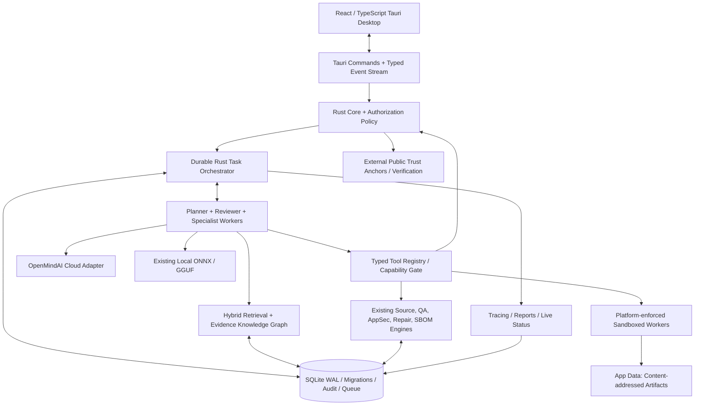

# CodeTwin-ML — Gap-Only Advanced Platform Implementation Master Prompt

> **Instruction to coding agent:** Work in `https://github.com/smshagor-dev/CodeTwin-ML`. This is an implementation mandate, not a proposal or an invitation to merely describe architecture. First inspect the current repository and its open/merged PRs, tests, migrations, security boundaries, and latest main. **Only implement capabilities that are absent or materially incomplete.** Do not rewrite working systems. Report what was actually implemented and tested; never claim functionality from mock-only evidence.

## 1. Mission and non-negotiable boundaries

Transform the existing local-first Software Digital Twin engineering workspace into a more capable, reliable, auditable, multi-agent engineering and research platform. Use PentAGI as a **capability comparison reference**, not as a code-copying requirement or a mandate to replicate offensive security tooling. Preserve CodeTwin-ML's differentiated source intelligence, evidence-backed findings, authorized security checks, verified repairs, and local-first design.

- **Existing stack:** Rust workspace, Tauri 2 desktop, React/TypeScript frontend, SQLite WAL and numbered migrations; existing local ONNX/GGUF inference. Keep **SQLite**; do not add PostgreSQL, Neo4j, Redis, or another mandatory database. If semantic retrieval needs vectors, implement a tested SQLite-compatible vector index/extension or a bounded local index with SQLite metadata and an explicit fallback. Preserve portability.
- **Cloud LLM provider:** `https://api.openmindai.org` (OpenMindAI Cloud). **Discover and verify its actual authentication, model-list, inference, streaming, tool-call and error contracts** from live authorized documentation/configuration before coding. Do not assume OpenAI compatibility or invent endpoints/model IDs. Provide configurable base URL and model discovery; use secure OS credential storage for API tokens, never SQLite, logs, Git, frontend source, or export files. Do not transmit local source content to cloud by default: require project-level explicit cloud disclosure consent, preview/redaction, bounded payload, and an offline-only mode.
- **Authorization:** all active security testing, code mutations, external network interactions, subprocess execution, repository changes, credential use, and potentially sensitive cloud transfers must pass their existing or stronger **explicit, scope-bound approval gates**. Planning is not execution. An agent, model output, plugin, imported document or tool result cannot grant approval or enlarge scope.
- **Security:** bounded passive analysis by default; no unauthorized intrusion, exploit automation, lateral movement, persistence, credential attacks, network scan expansion, or automatic deployment. Maintain current request/host/path budgets and deny policies. Tool adapters must not silently weaken isolation on unsupported operating systems. Fail closed.
- **Evidence:** separate observations, hypotheses, recommendations, applied changes, validated results and cryptographically verified artifacts. Never claim an LLM-generated statement is evidence. Never store signing private keys in SQLite or the repository. Existing external Ed25519 trust-anchor policy remains authoritative; clock checks are not trusted time or independent key custody.
- **Git hygiene:** inspect current main and open/merged PRs first; do not duplicate completed work. Use descriptive branches without `agent/` or `codex/`; avoid artificial phase/milestone labels in public PRs. Make small reviewable PRs, add regression tests and docs, fix CI, merge only after all required checks pass and mergeability is verified. Do not force-merge.

## 2. Mandatory source-level gap audit before implementation

Build a traceable matrix for every item below: `implemented / partial / missing / unverified`, with exact code paths, test references, runtime proof, risks, dependencies and acceptance criteria. README claims alone do not prove end-to-end behavior. Inspect the current Tauri commands, Rust crates, frontend routes, SQLite migrations, provider adapters, QA isolation, security policies and evidence signing. Search for functionality introduced after this prompt was authored. Record `docs/architecture/CAPABILITY_GAP_AUDIT.md` and update it as work progresses. **Never delete or replace a mature subsystem just to make the architecture uniform.**

Preserve and reuse existing: Tree-sitter incremental indexing; software digital twin file/symbol graph; dependency and LSP enrichment; static quality/AppSec/DB/runtime analysis; secret scanning and OSV audit; CycloneDX SBOM; authorized web security, source-aware endpoint mapping, risk planning and request budgets; guided remediation campaigns; hash-pinned patch approval, rollback and retesting; Windows strict QA sandbox; local ONNX/GGUF; SQLite evidence history; external evidence signing/trust-anchor verification.

## 3. Gap backlog — implement only what audit confirms is missing

### A. Real autonomous task runtime

Implement a **Rust-native, durable, dependency-aware orchestrator** that can accept a user goal, produce a structured plan, explain proposed actions, seek approval where required, execute approved tasks, evaluate evidence and revise its plan. Use a typed finite-state machine: `draft -> planned -> awaiting_approval -> queued -> running -> validating -> completed | failed | cancelled | blocked`, with resumable retry states and explicit reason codes. Reject invalid transitions and stale approvals. Task IDs, idempotency keys, project scope, owner, priority, dependency edges, attempt count, deadlines, resource budgets, cancellation tokens and durable execution records must be persisted in SQLite. Detect DAG cycles, runaway replanning and duplicate execution. No arbitrary unbounded autonomous loops.

Implement specialist workers with independently defined contracts, for example: Planner, Repository Analyst, Source Intelligence, Security Reviewer, Dependency/SBOM Analyst, QA/Test Planner, Repair Strategist, Documentation/Research, Evidence Verifier, Report Composer and Quality Reviewer. Workers can delegate via typed messages but cannot inherit permissions automatically. Run independent read-only work concurrently under bounded CPU/memory/time/queue limits; serialize conflicting mutations; apply per-project quotas and global backpressure. Support pause/resume/cancel, app restart recovery, partial failure and human override. A deterministic policy engine, not the LLM, is the final authority for tool permissions and state transitions.

### B. OpenMindAI Cloud provider and model gateway

Create a provider abstraction supporting current local inference and a verified OpenMindAI Cloud adapter. Implement securely configured credentials, connection diagnostics, discovered model capabilities, selectable per-role models, request IDs, timeouts, bounded retries with jitter, circuit breaking, rate/concurrency controls, streaming where actually supported, cancellation, structured output validation, and token/cost accounting only when reliable usage data is available. Tool calling must be schema validated and permission-gated; if the API lacks native tool calls, use a clearly documented structured-plan adapter without falsely claiming native support. Implement offline fallback **only when the user allows it**; never silently route private code to cloud or vice versa. Redact secrets, show data-sharing previews and audit cloud transfers without storing sensitive payloads.

### C. Persistent intelligent memory and retrieval

Implement layered memory: task working state, episodic run summaries, durable project facts, user-approved reusable knowledge and evidence references. Use SQLite as the system of record. Add local embeddings where possible, optional cloud embeddings only with explicit consent, semantic similarity retrieval, bounded hybrid keyword/vector search, relevance scoring, source hashes, timestamps, provenance, expiration, deduplication, deletion and reindexing. Extend the existing project/file/symbol graph into a **separate evidence-grounded knowledge graph** linking tasks, hypotheses, findings, tests, patches, sources, decisions and outcomes. Every edge must carry a source reference and confidence; never treat inferred edges as verified facts. Support cross-session retrieval without leaking knowledge across projects or users. Add context compaction and retrieval budgets with transparent omission reporting.

### D. Tool registry, isolation and bounded integrations

Implement typed tool descriptors with capabilities, platform availability, required approval, input/output schemas, timeout, resource budget, permitted network destinations, filesystem roots and audit policy. Reuse existing analyzers and QA mechanisms as first-party tools. Add **read-only** Git inspection, code search, dependency graph queries, SBOM inspection, safe document/PDF ingestion, test discovery, approved web research and evidence retrieval. External browser/search tools must be opt-in, source-cited, SSRF-resistant, URL-scheme/redirect constrained and respect project data disclosure. Never expose unrestricted shell or raw network access to the model. On Windows, reuse the strict sandbox where appropriate; on Linux/macOS, provide equivalent enforceable isolation before enabling execution, otherwise planning-only. Never label a worker sandboxed if enforcement is absent.

Any external security-tool integrations must be allowlisted, individually reviewed, non-destructive by default, and gated by existing authorized scope. Do **not** copy a penetration-testing framework's unrestricted exploitation workflows. Add an operator-visible capability matrix for supported platforms and disabled tools.

### E. Research, browsing and source verification

Add consented web/document research as a bounded workflow: query planning, search, safe retrieval, source metadata capture, deduplication, content extraction, citation records, contradiction detection and source freshness. Distinguish untrusted page text from instructions. Maintain linkable citations to exact retrieved source snapshots where licensing permits, with content hashes and timestamps. Summaries must indicate unsupported claims and retrieval errors. Research cannot automatically trigger active security scans or code changes.

### F. Reliability, reflection and self-correction

Add post-task validation against explicit success criteria, test evidence and policy checks. A reviewer role can flag unsupported conclusions and request bounded replanning, but cannot approve itself. Implement max-iterations, max-cost, max-runtime, retry categories, circuit breakers, checkpoint/recovery, lease expiration, crash-safe claim/release, stale worker detection and deterministic conflict handling. Ensure restart does not duplicate external side effects. Record truthful terminal outcomes (`verified`, `unverified`, `blocked`, `failed`, `cancelled`) and never translate a successful API response into a verified engineering result.

### G. Live desktop UI and operator experience

Extend existing Tauri/React UI rather than replacing it. Add: goal composer; project and cloud-consent selection; editable task DAG; specialist roster; live event timeline; streaming reasoning **summaries** (not hidden chain-of-thought); tool invocation cards; source/citation panel; memory explorer; approval inbox with exact scope and expiry; budget/cost meters; pause/resume/cancel; retry/error diagnostics; artifact preview; run comparison; searchable history; export/report view. Use typed Tauri events or a durable event cursor with replay on reconnect. Display real execution states, not simulated animations. Provide responsive layouts, keyboard access, accessible status indicators and dark/light mode. Clearly distinguish `planned`, `running`, `applied`, `tested` and `verified`.

### H. Collaboration and controlled APIs

If absent, implement optional multi-user/project collaboration without breaking offline single-user use: roles (viewer, analyst, approver, administrator), project isolation, scoped invitations, comment/review threads, approval separation of duties, revision history and conflict-safe updates. Expose a minimal authenticated local automation API only when enabled, with least privilege, loopback binding by default, CSRF/origin protections where relevant, per-token scopes, rotation/revocation, audit, and rate limits. Do not expose a public network listener by default. Choose REST or another interface based on existing stack; do not add GraphQL merely for feature parity.

### I. Reports, observability and evidence authenticity

Generate reproducible Markdown/HTML/JSON reports and PDF only if the repository's supported rendering path is reliable. Include goal, scope, approvals, tool versions, model/provider metadata, source citations, findings, attempts, unresolved risks, exact test outcomes, artifacts and provenance. Add structured tracing, correlation IDs, worker health, queue metrics, retry counts, performance counters, redacted logs, exportable diagnostics and operator alerts. Reuse existing signed-evidence infrastructure; do not invent self-authenticating signatures. Verify trust anchors and revision floors against independent external records; explicitly document remaining rollback and custody limits. No private signing key in SQLite/repo.

### J. Deployment, updates and developer ergonomics

Keep Tauri packaging and local-first startup. Add safe SQLite migration/backups and upgrade tests, startup health checks, feature flags, provider connectivity diagnostics, optional local model fallback, signed release/update verification where supported, and cross-platform compatibility documentation. Never make OpenMindAI Cloud connectivity a prerequisite for opening a local project. Avoid new always-on infrastructure dependencies. Provide configuration examples without credentials.

## 4. Target architecture

**Hard trust boundaries:** UI cannot invoke privileged operations directly; model output is untrusted; repository content is untrusted; external search pages are untrusted; credentials live in OS-protected storage; cloud egress requires consent; only the deterministic authorization layer grants capabilities; approved tool execution stays within immutable host/path/file/time/request budgets; signing authority remains outside CodeTwin.

## 5. Proposed Rust crate and SQLite module structure (adapt to current code)

Prefer incremental crates such as `crates/task-orchestrator`, `crates/model-gateway`, `crates/knowledge-memory`, `crates/tool-registry`, `crates/agent-observability`, and `crates/reporting` only when a new crate meaningfully isolates contracts. Reuse `crates/codetwin-core` and existing analyzers. Avoid needless microservices.

SQLite migrations should add appropriately indexed, foreign-key-enforced tables for: `workflow_runs`, `tasks`, `task_dependencies`, `task_attempts`, `worker_leases`, `execution_events`, `tool_invocations`, `approval_requests`, `approval_decisions`, `provider_requests`, `memory_items`, `memory_embeddings_or_index_refs`, `knowledge_nodes`, `knowledge_edges`, `source_records`, `artifact_refs`, `run_reports`, `collaboration_memberships`, `comments` and `audit_records` **only where missing**. Use transactions for state transitions, durable outbox/event replay, WAL busy-timeout strategy, bounded retention and migration rollback/backup tests. Store hashes and metadata for large artifacts; keep content-addressed bytes under app-data, not in unbounded SQLite blobs. Never persist API secrets or private signing keys.

## 6. Concrete end-to-end workflows

**Read-only engineering investigation:** user goal -> project selection -> plan -> parallel repository/source/dependency specialists -> evidence retrieval -> cross-check -> cited report -> verification status.

**Approved code repair:** issue evidence -> repair strategy -> exact diff and source-hash pin -> user approval -> isolated allowed execution -> patch apply with backups -> re-index -> targeted tests -> retest -> verified/unresolved report. No autonomous bypass of approval.

**Authorized security review:** target and scope approval -> bounded mapping -> safe detector selection -> paced checks within existing budgets -> evidence/source correlation -> human-reviewed remediation -> targeted verification -> signed export if external signing service is configured. No autonomous target expansion.

**Cloud-assisted research:** explicit cloud/data consent -> model discovery -> research plan -> approved retrieval -> source verification -> evidence-linked synthesis -> reproducible export; secrets and unapproved project code never leave the machine.

**Crash recovery:** kill application mid-run -> restart -> recover durable tasks/events -> detect stale leases -> reconcile idempotent operations -> mark uncertain external side effects blocked for operator review -> resume only safe work.

## 7. Tests and quality gates

Add unit, integration, property/fuzz where appropriate, contract, UI and full end-to-end tests. Cover: state transition legality, DAG cycles, worker races, idempotency, crash recovery, cancellation, lease expiration, partial failures, stale approvals, approval scope mismatch, prompt injection in source/pages/tool output, malicious tool arguments, SSRF/redirect escape, secret redaction, cloud-consent revocation, offline behavior, provider timeout/429/5xx, malformed JSON/stream chunks, invalid embeddings, cross-project retrieval isolation, graph provenance, report citation integrity, evidence signer rotation/revocation, private-key leak detection, and unsupported-platform fail-closed execution. Use mock providers for deterministic tests plus an **opt-in** real OpenMindAI Cloud smoke test with a non-sensitive fixture and a securely injected credential. Do not make live paid inference a default CI requirement.

Run the existing Rust, frontend, Python, Go, Windows QA and Tauri CI suites as applicable. Preserve existing security invariants and add explicit regression tests for every new capability. Use measurable performance budgets for concurrent workers, SQLite contention, memory, streaming latency and UI responsiveness. A green mock test alone is not proof of a live provider integration.

## 8. Execution protocol for the coding agent

1. Inspect main, open/merged PRs, workflow status, source tree, tests, and migrations; document evidence-based gaps and avoid duplication.
2. Prioritize dependency foundations: authorization contracts and task state machine -> durable queue/recovery -> provider gateway -> worker registry -> memory/retrieval -> safe tools/research -> UI/observability -> reporting/collaboration. Reorder only with documented technical reasons.
3. For each bounded change: write acceptance tests, implement source, update migrations/docs, run local tests, open a focused PR, inspect CI, fix failures, merge only when all required checks are green. Record PR URL and exact resulting main SHA.
4. Verify end-to-end user workflows on supported platforms. Mark unsupported integrations and environments honestly; no placeholder buttons, fake streams, fake completed tasks, or untested claims.
5. Update the gap matrix continuously; classify each item `verified implemented`, `partial`, `blocked` or `not started` with links to code/tests/CI. Do not silently skip items.
6. Never push secrets or private signing keys. If credentials, live endpoint documentation, external trust-anchor publication, signing hardware, or user authorization are unavailable, implement safe abstractions and tests, mark the specific blocker, and proceed to other independent tasks.
7. Continue iteratively until all feasible audited gaps have implementation and verification evidence. Do not declare the whole platform complete while blockers or unverified capabilities remain.

## 9. Final acceptance criteria

The deliverable is acceptable only when: existing features remain functional; the gap audit is source-backed; OpenMindAI Cloud works against a verified real contract with secure credentials and consent; real specialist workers execute bounded concurrent tasks; durable SQLite workflows survive restarts; semantic memory and graph retrieval show evidence provenance; model/tool outputs cannot bypass authorization; sandbox claims are platform-verified; approved repairs retain exact hash and retest gates; research sources are cited; UI reflects real status; reports distinguish evidence from suggestions; tests cover failures and security boundaries; required CI is green; docs and migrations are updated; PRs and final main commits are linked; and all remaining blockers are explicitly disclosed.

**Instruction priority:** Never sacrifice authorization, evidence integrity, privacy, platform isolation, or truthful reporting for feature parity or autonomous behavior. Build a stronger engineering platform, not an unrestricted autonomous attack system.
